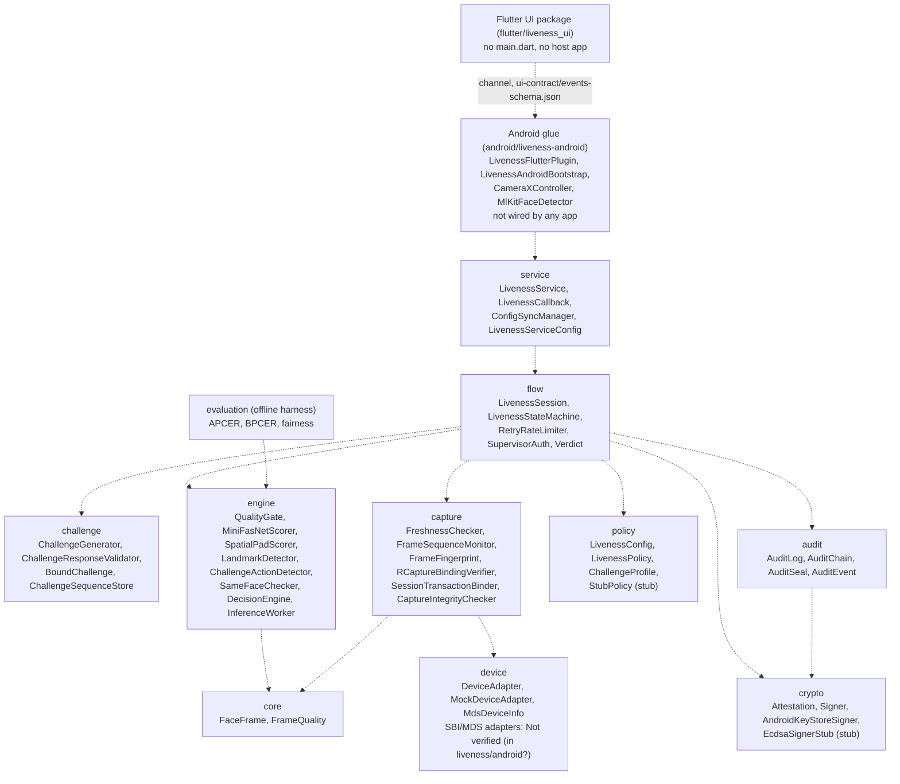

# Architecture (package level)

Source: class lists from `face-liveness-pad` (src/main/java/liveness/*), 2026-10-25.
All edges are INFERRED from class and package names, not read from source. Not verified.

## Not in this diagram (Not verified)
- liveness/android (36 files): SBI intent adapter, MDS HTTP adapter, JWT verifier, CrossStreamBinder, SFaceEmbedder, env integrity. Placement unknown.
- liveness/desktop, liveness/ui, liveness/util: not listed.
- Bench harness (android/bench-app): measures engine on-device, not part of the runtime flow.
- Real-time use: no app in the repo launches the plugin; no desktop main() exists.
